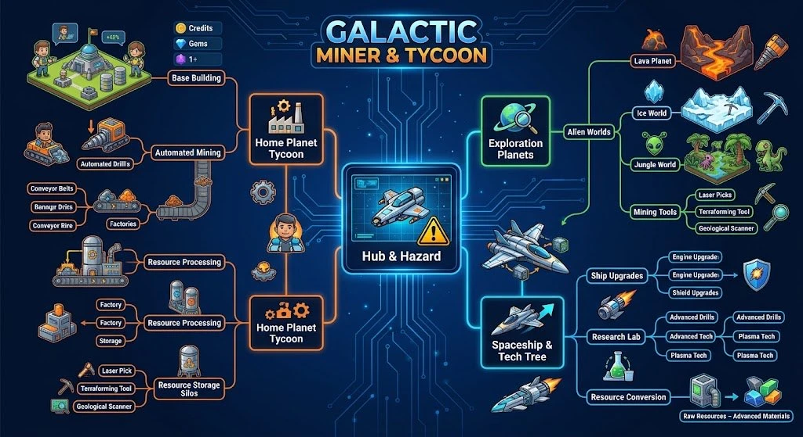

# Mindmap v1



_Bild: `bilder/mindmap-v1.webp` (KI-generierte Übersicht von Jos, Richtung des Spiels)._

## Text-Version
Die Grafik enthält einige Duplikate und Tippfehler (z. B. „Home Planet Tycoon“ und „Resource Processing“ doppelt). Hier die bereinigte Fassung:

```
Galactic Miner & Tycoon
├── Home Planet Tycoon  → spiel/02, 03, 04
│   ├── Base Building (Credits, Gems im HUD)
│   ├── Automated Mining: Automated Drills, Conveyor Belts, Factories
│   ├── Resource Processing: Factory, Storage
│   └── Resource Storage Silos
├── Hub & Hazard (Mitte: Raumschiff + Warnschild)  → spiel/09
├── Exploration Planets  → spiel/06, 07
│   ├── Alien Worlds: Lava Planet, Ice World, Jungle World
│   └── Mining Tools: Laser Picks, Terraforming Tool, Geological Scanner
└── Spaceship & Tech Tree  → spiel/05, 08
    ├── Ship Upgrades: Engine Upgrades, Shield Upgrades
    ├── Research Lab: Advanced Drills, Advanced Tech, Plasma Tech
    └── Resource Conversion: Raw Resources → Advanced Materials
```

## Offene Deutungen
- „Hub & Hazard“ – siehe `../spiel/09-hub-und-gefahren.md`
- Drittes Währungssymbol (violett, „1+“) – siehe `../spiel/10-wirtschaft-und-waehrungen.md`
- In der Grafik taucht „Geological Scanner“ und „Laser Pick“ auch im Heimatplanet-Ast auf; wir behandeln sie als Werkzeuge (`../spiel/07-werkzeuge.md`).
